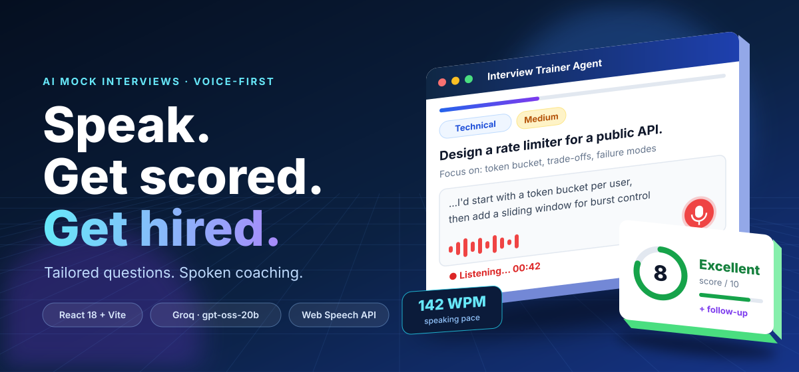
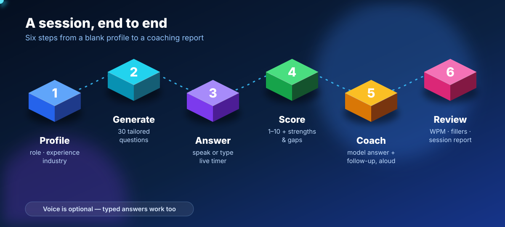
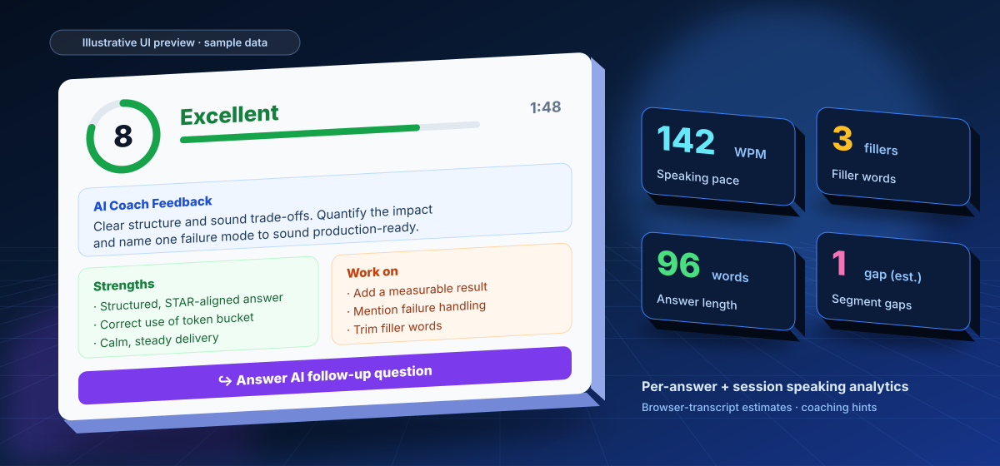
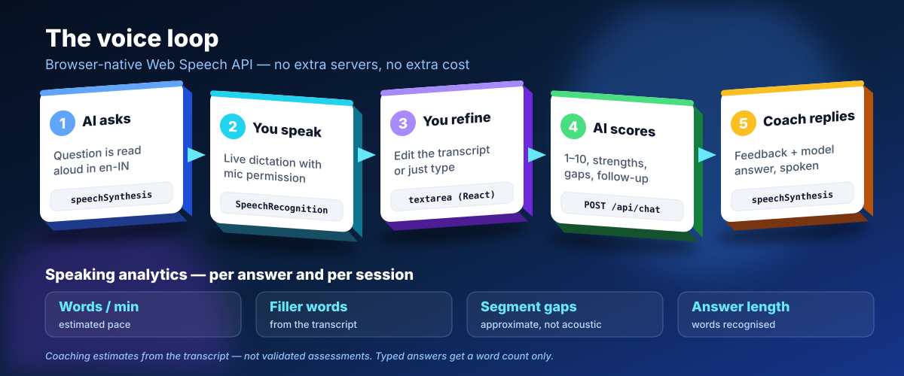
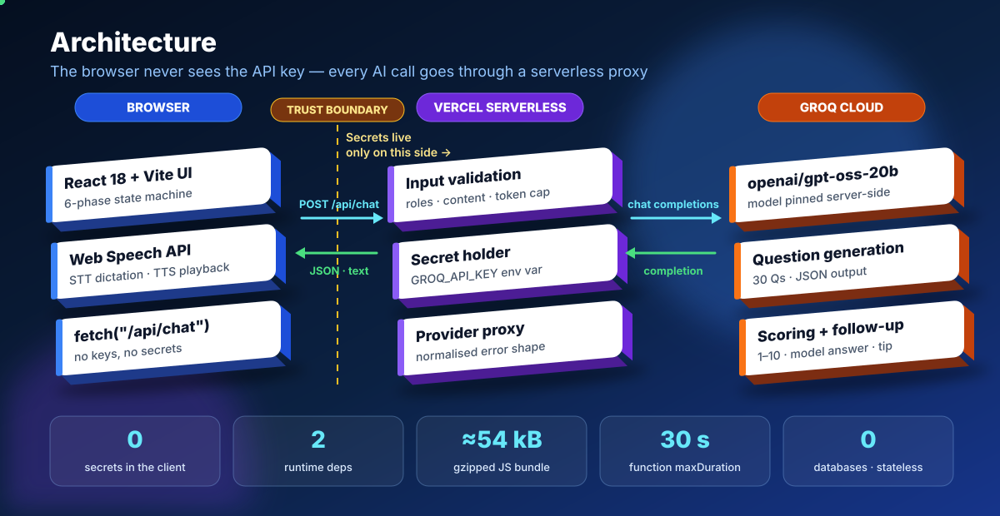

<div align="center">


<br/>


<br/>

> **"Stop guessing. Start acing."**
> An AI interview coach that adapts to *your* role, *your* experience, and *your* gaps — not a generic question bank.

<br/>

[🚀 Live Demo](https://interview-trainer-kohl.vercel.app) &nbsp;·&nbsp;
[📖 Docs](#-how-it-works) &nbsp;·&nbsp;
[🐛 Report Bug](https://github.com/Aditya152602/Interview-trainer/issues) &nbsp;·&nbsp;
[✨ Request Feature](https://github.com/Aditya152602/Interview-trainer/issues)

</div>

<p align="center">
  
</p>

## 👀 30-Second Overview

| | |
|---|---|
| **Problem** | Generic question banks don't adapt to your role — and typing answers is nothing like speaking them under pressure. |
| **Solution** | Role-aware 30-question sessions, **voice-first answers**, instant 1–10 scoring, spoken coaching and speaking analytics. |
| **Stack** | React 18 + Vite · Vercel Serverless Function · Groq (`openai/gpt-oss-20b`) · browser-native Web Speech API |
| **Engineering highlights** | API key never reaches the browser · server-side model pinning & token cap · stateless, no database · ≈54 kB gzipped JS · graceful fallback when voice isn't supported |
| **Try it** | [interview-trainer-kohl.vercel.app](https://interview-trainer-kohl.vercel.app) — no sign-up |

> 🧪 Reviewing this repo? Jump to [Engineering Highlights](#-engineering-highlights) for design decisions, trade-offs and scaling notes.

---

## ⚡ What Makes This Different

Most interview prep tools give you the same 50 questions everyone else studies.

**Interview Trainer Agent doesn't.**

Every session is freshly generated by the Groq-hosted `openai/gpt-oss-20b` model that understands your exact role, experience level, and industry — then scores your actual answers, not just checks if you memorized the right words.

```
You type:  "Java Developer | 3 years | FinTech"
AI builds: 30 tailored questions across 4 categories
You answer → AI scores → You improve → You get hired
```

---

## 🎬 Demo Flow

<p align="center">
  
</p>

```
┌─────────────────────────────────────────────────────┐
│  Step 1 → Fill your profile (role, exp, industry)  │
│  Step 2 → AI generates 30 personalized questions   │
│  Step 3 → Speak or type answers with a live timer  │
│  Step 4 → Get scored 1–10 and contextual follow-up │
│  Step 5 → Hear feedback + model answers aloud       │
│  Step 6 → Review technical + speaking indicators   │
└─────────────────────────────────────────────────────┘
```

---

## 🧠 Core Features

### 🎯 Intelligent Question Generation
- **30 questions per session** tailored to your exact role and experience
- **4 question types** — Technical, Behavioral (STAR), Situational, HR & Culture
- **3 difficulty tiers** — Easy, Medium, Hard — distributed intelligently
- Questions change every session — no repetition, no memorization

### 🤖 Real-Time AI Evaluation

<p align="center">
  
</p>

- **Score 1–10** with detailed reasoning for every answer
- **Strengths identified** — know what you're already doing right
- **Improvement areas** — specific, actionable, not vague
- **Model answer** — see exactly what a top-scoring response looks like
- **Pro tip** — one coaching insight per question to sharpen your style

### 🎙️ Full Voice Interview Mode

<p align="center">
  
</p>

- AI reads interview questions, feedback, and model answers aloud
- Speech-to-text fills the existing answer editor; candidates can edit transcripts or type instead
- Optional contextual follow-up questions based on each answer
- Speaking indicators: estimated words per minute, transcript filler words, and approximate recognition-segment gaps
- Browser voice support varies; Chrome/Edge are recommended for speech recognition

### ⏱️ Built for Realistic Practice
- **Live timer** per question — mirrors real interview pressure
- **Word counter** — trains you to give complete, thorough answers
- **STAR format prompt** — automatic reminder for behavioral questions
- **Session history** — full breakdown at the end with per-question scores

### 🔐 Secure by Design
- API key lives only in Vercel's environment — never in the browser
- No user data stored, no accounts required
- Zero tracking, zero ads

---

## 🧪 Engineering Highlights

> Small codebase, deliberate decisions. Here is what was chosen — and what it costs.

| Decision | Why | Trade-off |
|----------|-----|-----------|
| **Serverless proxy** (`api/chat.js`) instead of calling Groq from the browser | The API key stays server-side; the client only ever talks to `/api/chat` | One extra network hop |
| **Model pinned and tokens capped on the server** (`max_tokens` clamped to 4000) | A modified client can't switch models or inflate spend | Model changes need a redeploy |
| **Input validation at the API boundary** (non-empty `messages`, valid roles, string content) with a consistent `{ error: { message } }` shape | Bad requests fail fast with predictable errors the UI can render | Slightly more server code |
| **Stateless — no database, no accounts** | Privacy by design, zero ops, nothing to leak | No cross-session history (on the roadmap) |
| **Browser-native Web Speech API** for STT/TTS | $0 cost, no audio pipeline to host, low latency, works inside the existing editor | Support varies by browser; some browsers process audio via vendor services (documented in [`VOICE_ASSISTANT.md`](VOICE_ASSISTANT.md)) |
| **Honest analytics** — pace, fillers and gaps are labelled *estimates* | Avoids over-claiming what a transcript can tell you | Less "magic" than a marketing page might want |
| **Defensive LLM output handling** — markdown fences stripped before `JSON.parse`, errors surfaced to the user | Models sometimes wrap JSON in code fences | A malformed reply surfaces an error instead of silent failure |
| **Minimal dependencies** — only `react` and `react-dom` at runtime, inline styles | Tiny bundle (≈54 kB gzipped), nothing to audit | No design-system conveniences |
| **Explicit 6-phase UI state machine** (`setup → gen → interview → eval → feedback → done`) | Every screen has one clear owner and transition | Single large component today — a natural split point |

### 📈 If this had to scale

These are **not built yet** — they are the next engineering steps and why:

- **Rate limiting** per IP/session (e.g. a KV store) — protect the shared Groq quota
- **Streaming responses** — lower time-to-first-token on question generation
- **Prompt regression tests / eval harness** — keep scoring consistent across model changes
- **Observability** — structured logs, latency and error-rate dashboards on `/api/chat`
- **Whisper-based STT fallback** — voice for browsers without `SpeechRecognition`
- **Auth + persisted history** — progress over time, with explicit user consent
- **Accessibility audit** — keyboard flow and screen-reader labels for the voice controls

---

## 🏗️ How It Works

<p align="center">
  
</p>

```
┌──────────────────────────────────────────────────────────────┐
│                        USER BROWSER                          │
│                    React + Vite Frontend                     │
│          (No API keys, no secrets, just UI logic)           │
└─────────────────────┬────────────────────────────────────────┘
                      │  POST /api/chat
                      │  { system prompt + messages }
                      ▼
┌──────────────────────────────────────────────────────────────┐
│                 VERCEL SERVERLESS FUNCTION                   │
│                       api/chat.js                            │
│         (API key secured as environment variable)           │
└─────────────────────┬────────────────────────────────────────┘
                      │  Authenticated request
                      ▼
┌──────────────────────────────────────────────────────────────┐
│                       GROQ CLOUD API                         │
│                    openai/gpt-oss-20b                        │
│             Model configured in api/chat.js                  │
└──────────────────────────────────────────────────────────────┘
```

---

## 🗂️ Project Structure

```
interview-trainer/
│
├── 📁 api/
│   └── chat.js              ← Serverless function (Groq proxy)
│
├── 📁 assets/
│   ├── hero.svg             ← README banner (animated, 3D-style)
│   ├── workflow.svg         ← Session flow diagram
│   ├── architecture.svg     ← Browser → Serverless → Groq
│   ├── voice-loop.svg       ← Voice pipeline diagram
│   └── scorecard.svg        ← Feedback screen preview
│
├── 📁 src/
│   ├── main.jsx             ← React entry point
│   └── App.jsx              ← Complete app (all 6 phases)
│
├── index.html               ← HTML shell
├── package.json             ← Dependencies
├── vite.config.js           ← Vite configuration
├── vercel.json              ← Deployment + timeout config
├── .env.example             ← Environment variable template
└── VOICE_ASSISTANT.md       ← Voice setup, limitations and deployment guide
```

---

## 🚀 Quick Start

### Prerequisites
- Node.js 18+
- A free [Groq API key](https://console.groq.com)
- A free [Vercel account](https://vercel.com)

### Local Development

```bash
# 1. Clone the repo
git clone https://github.com/Aditya152602/Interview-trainer.git
cd Interview-trainer

# 2. Install dependencies
npm install

# 3. Set up environment
cp .env.example .env
# Add your Groq key → GROQ_API_KEY=gsk_...

# 4. Install Vercel CLI
npm install -g vercel

# 5. Run locally (frontend + API together)
vercel dev
# → Open http://localhost:3000
```

### Deploy to Production

```bash
# Push to GitHub
git add .
git commit -m "Deploy interview trainer"
git push origin main

# On Vercel:
# 1. Import GitHub repo
# 2. Add env var: GROQ_API_KEY = gsk_...
# 3. Deploy → live in 30 seconds
```

---

## 🔑 Environment Variables

| Variable | Description | Where to get |
|----------|-------------|--------------|
| `GROQ_API_KEY` | Groq API authentication key | [console.groq.com](https://console.groq.com) → API Keys |

> **Security note:** This key never reaches the browser. It lives exclusively inside Vercel's serverless runtime.

---

## 📊 Question Distribution

| Category | Count | Purpose |
|----------|-------|---------|
| ⚙️ Technical | 12 | Role-specific skills and knowledge |
| 🧠 Behavioral | 8 | STAR-format situation responses |
| 💡 Situational | 6 | Problem-solving and judgment |
| 🤝 HR & Culture | 4 | Fit, values, and communication |
| **Total** | **30** | **Full interview simulation** |

---

## 🛠️ Tech Stack

| Layer | Technology | Why |
|-------|-----------|-----|
| Frontend | React 18 + Vite | Fast, modern, component-based |
| AI Engine | `openai/gpt-oss-20b` via Groq | Existing server-side model configuration |
| API Layer | Vercel Serverless Functions | Secure key proxy, zero config |
| Deployment | Vercel | GitHub integration, instant deploys |
| Styling | Pure inline CSS | Zero dependencies, full control |

---

## 🗺️ Roadmap

- [ ] Resume upload → auto-generate role-specific questions
- [x] Voice answer mode with speech-to-text and spoken AI responses
- [x] Contextual AI follow-up questions
- [x] Transcript-based speaking indicators
- [ ] Multi-round simulation (HR → Technical → Managerial)
- [ ] Answer history across sessions
- [ ] Company-specific question packs (Google, Amazon, etc.)
- [ ] Confidence score trend graph over time

---

## 🤝 Contributing

```bash
# Fork → Clone → Branch → Build → PR
git checkout -b feature/your-amazing-feature
git commit -m "Add: your amazing feature"
git push origin feature/your-amazing-feature
```

---

## 📄 License

Distributed under the MIT License.

---

<div align="center">


**Built with 💙 by [Aditya Dwivedi](https://github.com/Aditya152602)**

*If this project helped you land an interview — drop a ⭐ on the repo.*

<br/>


&nbsp;&nbsp;

&nbsp;&nbsp;


</div>
